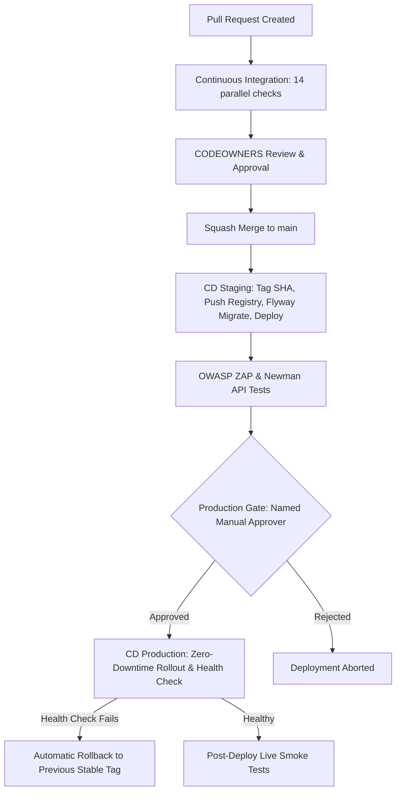

# Contributing to E-NAKO MoneyFlow

Welcome to the **E-NAKO MoneyFlow** engineering team.

This platform moves real funds across Central African CEMAC borders and mobile money networks. Because a defect or unauthorized commit can cause direct financial loss, our engineering standards, review gates, and automated checks are strictly enforced.

---

## 1. Quickstart from Fresh Clone

### Prerequisites

- **Node.js**: `v20.x` or later
- **pnpm**: `v10.x` or `v12.x` (`npm install -g pnpm`)
- **Java**: `JDK 21` (Eclipse Temurin recommended)
- **Maven**: `3.9.x`
- **Docker & Docker Compose**: For local PostgreSQL 16 container

### Setup

```bash
# 1. Clone repository
git clone https://github.com/enako-group/moneyflow.git
cd moneyflow

# 2. Run automated setup (copies .env.example -> .env, installs dependencies, initializes Husky)
make setup
```

To run all services concurrently:

```bash
make dev
```

- **PostgreSQL 16**: `localhost:5432` (`moneyflow` / `postgres`)
- **Backend API**: `http://localhost:8080`
- **Admin Dashboard**: `http://localhost:5173`
- **Customer Web Portal**: `http://localhost:3000`

---

## 2. Commit and Branch Guidelines

### Branch Naming

Direct pushes to `main` are strictly blocked. All work must occur on a feature branch created from `main`:
`<type>/<short-description>`

Examples:

- `feat/wallet-escrow-hold`
- `fix/reconciliation-rounding`
- `chore/upgrade-turborepo`
- `refactor/audit-log-publisher`

### Conventional Commits

All commit messages must follow the [Conventional Commits](https://www.conventionalcommits.org/) standard. Commits are validated locally via Husky + commitlint upon creation:

```
<type>(<scope>): <subject>
```

Allowed types:

- `feat`: A new feature or capability
- `fix`: A bug fix
- `chore`: Maintenance, dependencies, tooling
- `refactor`: Code change that neither fixes a bug nor adds a feature
- `test`: Adding or correcting tests
- `docs`: Documentation updates only
- `ci`: CI/CD pipeline or workflow changes
- `perf`: Performance improvements
- `revert`: Reverting a previous commit

---

## 3. Pre-Commit Validation & Secret Scanning

Before every commit, Husky triggers:

1. **Secret Scanning (`scripts/check-secrets.js` & `.gitleaks.toml`)**:
   Scans the diff for private keys, AWS access tokens, passwords, and DB connection strings. Any matching pattern halts the commit immediately.
2. **Lint-Staged**:
   Automatically formats and lints staged `.ts`, `.tsx`, `.js`, and `.json` files.

> ⚠️ **Warning**: Never use `--no-verify` to bypass pre-commit hooks. The GitHub CI workflow runs the exact same checks and will immediately reject any unverified pull request.

---

## 4. Definition of Done & `make verify`

Before creating a Pull Request, run:

```bash
make verify
```

`make verify` performs:

1. Secret pattern scan across the diff
2. Code formatting check (`prettier --check`)
3. Linting across all workspace apps (`eslint`)
4. TypeScript strict compilation across all packages (`tsc --noEmit`)
5. Full production builds for all applications

A PR can only be merged when `make verify` passes with **0 errors**.

---

## 5. Code Ownership & Dual Approval (CODEOWNERS)

To satisfy financial dual-control regulations (Four-Eyes Principle), code touching sensitive modules requires designated reviews:

| Path / Module                 | Required Approvers                                 | Rationale                              |
| ----------------------------- | -------------------------------------------------- | -------------------------------------- |
| `apps/backend/**/ledger/**`   | `@enako-finance-leads`, `@enako-security-leads`    | Double-entry bookkeeping integrity     |
| `apps/backend/**/wallet/**`   | `@enako-finance-leads`, `@enako-security-leads`    | Escrow holds & available balance logic |
| `apps/backend/**/approval/**` | `@enako-compliance-leads`, `@enako-security-leads` | Dual-control checker workflows         |
| `apps/backend/**/payment/**`  | `@enako-payments-leads`, `@enako-security-leads`   | Aggregator integrations (MTN/Orange)   |
| `infra/**`                    | `@enako-devops-leads`, `@enako-security-leads`     | Cloud security, IAM & network policies |

---

## 6. CI/CD Lifecycle Explained



### 1. Continuous Integration (PR Phase)

Every PR triggers 14 discrete, mandatory checks:

- **Backend**: Maven compile, JUnit 5 unit tests, Testcontainers integration tests, ArchUnit boundary rules, Sonar quality gate, OWASP dependency vulnerability check.
- **Frontend**: Frozen lockfile verification, ESLint/Prettier check, TypeScript type-check, component tests, Vite & Next.js production builds, Playwright smoke tests.
- **Security & Compliance**: Full-diff Gitleaks scan, commitlint PR title & commits.

### 2. CD Staging (Merge to `main`)

- Container image tagged with git commit SHA and pushed to container registry.
- Backward-compatible Flyway migrations executed.
- Automatic deployment to Staging environment.
- Automated Newman API tests (48 scenarios) and OWASP ZAP security scan.

### 3. CD Production (Promotion Phase)

- **Immutable Artifact Promotion**: The exact container image digest that passed Staging is deployed to production. No rebuilds occur.
- **Hard Manual Approval Gate**: Requires named sign-off in GitHub Environments.
- **Automated Rollback**: If `/actuator/health` fails within 30 seconds of rolling deployment, traffic immediately reverts to the previous version and alerts the operations desk.
- **Post-Deploy Smoke Tests**: Validates live read-only endpoints before sign-off.
